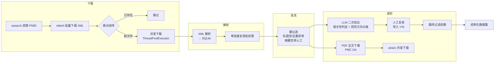

# 马铃薯文献批量下载与清洗系统

基于 NCBI E-utilities API，批量下载 PubMed 中全部马铃薯相关文献（不限研究方向：分子生物学、遗传育种、栽培生理、植物保护、加工储藏、品质营养等），
经过解析、去重、质量过滤、LLM 二次验证，最终产出结构化数据集，
用于知识图谱构建或智能体效果评测。

## 特性

- **并发下载** — XML 批次下载自动并发（`ThreadPoolExecutor` + 全局速率限制器），充分发挥 NCBI API 配额
- **自适应日期切分** — 命中超阈值自动对半递归细分（年→月→日），规避 NCBI `retstart` 10000 硬上限导致的静默截断
- **检索式实测调优** — 补 18 个野生近缘种、甘薯排除改为「无马铃薯学名证据才排除」，净增 208 篇且零丢失（见[检索式调优](#检索式调优)）
- **二级过滤** — 硬过滤（规则引擎：标题空/去重排除，摘要空转人工）→ LLM 验证（多 Provider，相关性判定 + 研究方向分类）
- **断点续传** — XML 批次自动跳过已下载文件；LLM 验证崩溃后可恢复；PDF 下载失败可 `--step pdf-retry` 续跑
- **多 Provider** — 支持 DeepSeek、智谱 GLM、OpenAI 兼容 API 三种 LLM 后端
- **智谱 Batch API** — 异步批量验证，支持中断恢复与自动降级同步模式重试
- **数据库复用连接** — 所有批处理操作复用单连接，减少连接开销

## 关于文献格式

PubMed E-utilities 下载的是 **XML 格式的元数据**（标题、摘要、关键词、MeSH词、作者等），
**不是 PDF**。这对后续分析已经足够，因为：
- 90% 的关键信息可从摘要中提取
- XML 结构化程度高，解析准确
- 不存在版权问题，可自由下载

如需全文，PMC 开放获取文章可通过 `--step pdf` 参数额外下载 PDF，失败后可 `--step pdf-retry` 续传。

## 项目结构

```
Potato-Literature-Search/
├── config/
│   ├── __init__.py
│   ├── settings.py              # 全局配置（API Key、路径、搜索词、LLM 配置等）
│   └── .env.example             # 环境变量模板（复制为 .env 后填入密钥）
├── downloader/
│   ├── __init__.py
│   ├── pubmed_downloader.py     # NCBI E-utilities 批量下载 XML（并发 + 速率限制）
│   └── pdf_downloader.py        # PMC 全文下载（PDF/TXT），失败导出清单 + checkpoint 断点续传
├── parser/
│   ├── __init__.py
│   └── xml_parser.py            # XML 解析 → SQLite（复用单连接写入）
├── cleaner/
│   ├── __init__.py
│   ├── hard_filter.py           # 硬过滤（标题空/去重排除，摘要空转人工审核）
│   └── llm_validator.py         # LLM 二次验证（支持 DeepSeek / Zhipu / OpenAI）
├── utils/
│   ├── __init__.py              # now_iso() 工具函数
│   ├── logger.py                # 统一日志
│   └── db.py                    # 数据库工具函数（含三张表）
├── data/
│   ├── raw_xml/                 # 原始 XML 文件
│   ├── processed/               # SQLite 数据库（potato_lit.db）
│   ├── output/                  # CSV 输出
│   └── pdfs/                    # LLM 判定相关文献的 PDF 全文（无 PDF 时 .txt）
├── logs/                        # 运行日志
├── tests/                       # 单元测试
├── main.py                      # 一键运行入口
├── requirements.txt
├── AGENTS.md                    # AI 助手开发指南（本地文件，不纳入版本控制）
└── README.md
```

## 流水线架构



> **注意**：`--step all`（默认）仅执行 **下载 → 解析 → 清洗**（硬过滤）。
> LLM 验证、导入复核、PDF 下载为独立步骤，需通过对应 `--step` 参数单独执行。

### 检索式调优

检索式在 `config/settings.py`，由五段拼装：`POTATO_CORE`（栽培马铃薯）、`POTATO_RELATIVES`（18 个野生近缘种）、`SWEET_POTATO`（甘薯干扰项）、`TUBEROSUM_EVIDENCE`（马铃薯学名证据）、`EXCLUSIONS`。

2026-10 做了一轮基于**真实判定**的调优：每个候选改动都先用 `retmax=0` 计数估规模，再把新增文献下载下来用生产提示词实判，统计「新增篇数中真相关占比」——占比低的改动一律否决。

| 候选改动 | 净增篇数 | 实判相关 | 结论 |
|---|---|---|---|
| 甘薯排除改为「无马铃薯学名证据才排除」 | +142 | **43（30.3%）** | 采纳 |
| 补 18 个野生近缘种（`Solanum sect. Petota`） | +66 | **55（77.5%）** | 采纳 |
| 俗名 `tater/spud/pomme de terre/patata` | +197 | 3（1.5%） | 否决 |
| `"papa"`（西语马铃薯） | +1054 | 0（0%） | 否决 |

最终效果：**31348 → 31556 篇**，净增 208 篇，**零丢失**（集合用 `fetch_pmid_list` 的日期自适应切分逐条核验，非估算）。

2026-10-18 用新检索式真实重跑全链路（下载 → 解析 → 硬过滤 → LLM 验证）后，净增 208 篇的真实判定：

| 项 | 值 |
|---|---|
| 净增 208 篇中入库并可判定 | 199 篇（另 9 篇摘要为空，转人工复核） |
| 判 `RELEVANT` | **96 篇（48.2%）** |
| 判 `NOT_RELEVANT` | 103 篇 |
| 方向分布 | 分子生物学 41 / 遗传育种 14 / 品质营养 11 / 栽培生理 10 / 加工储藏 9 / 植物保护 8 / 综述评论 2 / 其他 1 |

实跑相关率（48.2%）比事先抽样估算（30.3%）高，因为估算样本只覆盖甘薯误伤救回的部分，实跑还含野生近缘种那批高相关文献。

三个容易踩的坑：

1. **`A AND NOT B` 与 `A NOT B` 不等价。** 实测 `(CORE) AND NOT "Solanum tuberosum"[MeSH]` 返回 12136（等于交集数），而 `(CORE) NOT "..."` 返回正确的 22769。检索式里排除子句必须用 `NOT`，不能带 `AND`。
2. **野生近缘种在 MeSH 里没有独立主题词。** `"Solanum chacoense"[MeSH Terms]` 等全部返回 0，只有 `"Solanum"[MeSH Terms]`（33742）和 `"Solanum tuberosum"[MeSH Terms]`（12136）。所以只能靠 `[Title/Abstract]` 补，不能指望 MeSH。
3. **甘薯排除的「证据」只能是 `Solanum tuberosum`，不能用 `potato`。** 甘薯论文里的 potato 指的就是甘薯，拿它当证据等于没排除。

`tests/test_settings.py::TestSearchQuery` 锁定上述结构（含括号配对与 `AND NOT` 禁用），防止有人把检索式改回简写。

### 过滤与分类规则

**硬过滤（规则引擎）** 只保留记录完整性相关的机械规则，并含一条**转人工**分支：

| 规则 | stage | reason | 说明 |
|------|-------|--------|------|
| 重复标题 | `hard_filter` | `duplicate_title` | 同 `(title, journal, pub_year)` 保留最小 PMID，优先级最高 |
| 标题为空 | `hard_filter` | `title_empty` | 空白串亦算空 |
| 摘要为空 | `needs_review` | `abstract_empty` | 空白串亦算空；**不排除、不进 LLM**，直接转人工复核 |

判定优先级：重复标题 > 标题为空 > 摘要为空，同时命中只写一条记录。

**摘要为空为什么转人工而不是排除**：这类文献绝大多数是 PubMed 早期（1940–1980）无摘要字段年代的记录，或 Letter/简讯/勘误类短文；模型只能看标题，判定不可靠。它们会以 `llm_verdict='NEEDS_REVIEW'` 出现在 `llm_review_pending_*.csv` 里，由人工判 Y/N，判完即写入 `llm_validation` 并进入正常导出链路。

已在 2026-10 取消的规则**不要加回**：语言非英文、摘要 `<80` 字符、发表年份越界、文章类型黑名单（Letter/Editorial/Comment 等）、标题 `<10` 字符。
这些维度改由 LLM 二次验证承担——非英文、短摘要、Letter 类文献同样可能是相关研究。

**研究方向分类**：LLM 验证对判定为 `RELEVANT` 的文献额外输出 `research_field`，取值限定为 `config/settings.py` 中 `RESEARCH_FIELDS` 的十项封闭枚举：

分子生物学 / 遗传育种 / 栽培生理 / 植物保护 / 加工储藏 / 品质营养 / 产后处理 / 产业经济 / 综述评论 / 其他

`NOT_RELEVANT` 的方向留空；方向缺失或越界时回落 `其他`，不会因此判定失败重试。

**LLM 提示词规则**：系统提示词由三块规则组成，均经 300 篇真实文献基准集 A/B 测试确定（见下节）：

1. **核心判定**——文献是否以马铃薯（或其近缘种、块茎/植株/种质资源、病虫害互作、加工产品）为研究对象或重要研究材料；正向覆盖全部研究方向，负向明确 `sweet potato / Ipomoea batatas`（甘薯）为主要研究对象时排除。
2. **顺带提及判定**——通用方法/多物种并列/仅作对照背景/名称陷阱四类一律 `NOT_RELEVANT`，配两条判定问句（「去掉马铃薯结论是否仍成立」）。
3. **输出前自检**——先回答 Q1（是否核心研究对象）、Q2（是否仅出现在列表/对比/背景），理由与结论不得矛盾。

**未启用**的两块规则：**默认倾向**（证据不足倾向排除，实测会漏收边缘正例）与**物种甄别**（显式列举甘薯/木薯/番茄/非马铃薯 Solanum，对 glm 收益大但对当前生产的 deepseek 会多误排正例）。详见下方选型理由。

**提示词基准测试**：`bench_run.py` + `bench_analyze.py` + `bench_prompts.py` 用 300 篇历史复核文献做量化对比。

> **每个版本必须跑 3 次取多数票。** 实测即使 `temperature=0`，同一提示词连续两次运行的判定翻转率也有 2.4–2.7%；单次运行的差异会把随机噪声伪装成提示词效果。投票后三票一致率 96–98%，仍有约 3% 样本在边界上摇摆。

干净金标准集（`pos` 层 150 篇人工确认 Y + `sweet_potato_mention` 层 30 篇明确该排除，共 180 篇，不受收录标准变更污染）上的**配对口径**准确率（只统计该模型下各版本都有结果的样本，避免限流导致样本数不等而比较不同难度子集）：

| 版本 | 规则 | glm-4-Flash | deepseek-v4.1-flash | 跨模型平均 | 跨模型最差 |
|------|------|-------------|---------------------|-----------|-----------|
| V1 | 无规则（删示例后状态） | 0.9576 | 0.9944 | 0.9760 | 0.9576 |
| V2 | +顺带提及规则 | 0.9636 | 0.9889 | 0.9763 | 0.9636 |
| **V3（当前生产版本）** | **+输出前自检** | **0.9879** | **0.9944** | **0.9912** | **0.9879** |
| V4 | V3+默认倾向 | 0.9818 | 0.9889 | 0.9854 | 0.9818 |
| V5 | V3+物种甄别 | 0.9879 | 0.9889 | 0.9884 | 0.9879 |
| V6 | V5+默认倾向 | 0.9818 | 0.9944 | 0.9881 | 0.9818 |
| V7 | V3+修正版物种甄别 | 0.9706 | 0.9944 | 0.9825 | 0.9706 |

全 300 篇（含历史 N 标签，严格口径，仅参考）准确率 V3 为 glm 0.743 / deepseek 0.807。

**选型理由**：V3 的跨模型平均（0.9912）与最差（0.9879）均为 7 个版本中最高，且提示词最短（1842 字符，比 V5 少 506 字符）：

- V3 与 V5 在 glm 上完全打平（均 0.9879），在 deepseek 上 V3 略高（0.9944 vs 0.9889）。两者实际分歧只有 3 篇：glm 上 V3 多错 1 篇甘薯（42066814，IbGBSS1 甘薯 CRISPR）、V5 多错 1 篇正例（39271954，Solanum 糖苷生物碱）；deepseek 上 V5 多错 1 篇正例（31277248，PIN 生长素转运蛋白，标题明确含 "in Solanum tuberosum"）。
- 物种甄别块对 glm 有实质收益（甘薯误收 0.9333→0.9667，全库预估误收 112→56 篇），但对 deepseek 无增量甚至有害（V1 基线甘薯误收已是 3%）。当前生产用 deepseek，取 V3 的零真错。
- V7 实验证伪了「删掉物种甄别块里那句矛盾规则」的想法：删掉「其他 Solanum 属非马铃薯物种一律排除」后，glm 上甘薯误收反弹到 4/30（0.9706）。**那句话是物种甄别块的严格性锚点，删不得**——若将来切回 glm，应直接启用 V5 而非修 V5。
- 不启用「默认倾向」（V4/V6）：它会让**实验宿主是番茄、研究对象却是马铃薯病原**的文献被误排（如 PSTVd 马铃薯纺锤块茎类病毒，deepseek 上 V6 因此漏收 PMID 32719659）。漏收比误收更难发现。

**复现方式**：

```bash
python bench_run.py --repeat=3      # 每版本跑 3 遍，多数票合并
python bench_analyze.py             # 两模型结果并排对比，含配对口径表
```

各次原始运行缓存在 `bench_out/_run{i}_<版本>__<模型>.json`，主结果按模型分文件（`bench_results_<版本>__<provider>-<model>.json`），切换模型不会互相覆盖。

**历史数据迁移**：取消规则前留下的排除记录需要清理，否则相关文献永远进不了 LLM 验证。

```bash
python scripts/migrate_relax_hard_filter.py           # 先看会清理多少（dry-run）
python scripts/migrate_relax_hard_filter.py --apply   # 确认后写库
python scripts/incremental_update.py --validate --export   # 重跑，补上研究方向
```

迁移只删由**已取消规则**写下的 `filter_log` 排除记录，以及 `human_review IS NULL` 的 `llm_validation` 记录；人工复核过（Y/N）的结论一律保留。

## 快速开始

```bash
# 1. 安装依赖
pip install -r requirements.txt

# 2. 配置 API Key
#    复制 config/.env.example 为 config/.env，填入你的真实密钥
#    可选：设置 PROXY=http://127.0.0.1:7890 走代理访问 NCBI 等外网（留空直连）
#    .env 已加入 .gitignore，不会误提交

# 3. 运行核心流程（下载 → 解析 → 硬过滤）
python main.py

# 4. LLM 二次验证
#    在 config/.env 中设置 LLM_PROVIDER（"deepseek" / "zhipu" / "openai"）
#    以及对应 provider 的 API Key，无需改动 settings.py
python main.py --step validate

# 5. 导入人工复核结果（在导出的 CSV 中标注 Y/N 后）
#    复核清单里 llm_verdict='NEEDS_REVIEW' 的行是摘要为空转人工的文献，
#    判 Y/N 后会新建 llm_validation 行，同样进入导出链路
python main.py --step import-review

# 5.1 导出复核通过文献（同时产出三份 CSV，均落在 data/output/exports/full/）
#     articles_raw_*.csv            仅 articles 原生字段（15 列）
#     llm_filtered_*.csv            附加 llm_verdict / llm_reason / research_field / human_review（17 列）
#     by_field/<方向>/              按 research_field 一方向一目录，目录内两份：
#                                     llm_filtered_by_field_<方向>_*.csv  同 llm_filtered（17 列）
#                                     articles_raw_by_field_<方向>_*.csv  同 articles_raw（15 列，无 LLM 信息）
#     另附 llm_filtered_by_field_index_*.csv 记录各方向篇数、目录与两份文件名
python main.py --step export

# 批量验证（智谱专用，异步处理大文献集）
python main.py --step validate --batch

# 6. 下载 OA 全文 PDF
python main.py --step pdf                     # 仅下载 OA 全文 PDF
python main.py --step pdf-retry               # 仅重试之前失败的下载（断点续传）
```

### 单步运行

```bash
# 仅下载 XML（支持断点续传，已存在的批次自动跳过）
python main.py --step download

# 仅解析 XML → SQLite（可指定 XML 目录）
python main.py --step parse
python main.py --step parse --xml-dir data/raw_xml

# 仅硬过滤
python main.py --step clean

# 下载 OA 全文 PDF
python main.py --step pdf

# 仅重试之前失败的 OA PDF 下载（断点续传，可中断后重复执行）
python main.py --step pdf-retry

# LLM 二次验证（同步模式 5 篇/批）
python main.py --step validate

# LLM 二次验证（智谱 Batch API 异步模式，每篇独立请求）
python main.py --step validate --batch

# 导入人工复核 CSV（自动查找最新复核文件）
python main.py --step import-review
# 指定复核文件
python main.py --step import-review --csv data/output/review/llm_review_pending_20250101_120000.csv

# 导出复核通过文献（articles_raw_*.csv 原始字段 + llm_filtered_*.csv 含研究方向分类）
python main.py --step export

# 自定义搜索词
python main.py --query "potato AND drought AND gene"
```

### 常用参数速查

| 参数 | 适用阶段 | 说明 |
|------|----------|------|
| `--step` | 全部 | 运行指定阶段（download / parse / clean / pdf / pdf-retry / validate / import-review / export / all） |
| `--batch` | validate | 使用智谱 Batch API 异步验证（仅 `LLM_PROVIDER=zhipu` 时生效，否则自动降级同步） |
| `--query` | download / all | 自定义 PubMed 搜索词 |
| `--xml-dir` | parse / all | XML 文件目录（默认 `data/raw_xml/`） |
| `--csv` | import-review | 人工复核 CSV 文件路径（默认自动查找最新文件） |
| `--skip-filter` | 增量更新 | 跳过硬过滤阶段（仅 `scripts/incremental_update.py`） |

### LLM 配置（全部通过 `config/.env` 覆盖）

模型与并发等参数不再写死在 `config/settings.py` 里，改 `.env` 即可切换，无需动源码。

| 环境变量 | 默认值 | 说明 |
|----------|--------|------|
| `LLM_PROVIDER` | `openai` | `deepseek` / `zhipu` / `openai`（openai 指 OpenAI 兼容协议，可指向任意网关） |
| `OPENAI_BASE_URL` | `http://127.0.0.1:3425/v1` | OpenAI 兼容网关地址 |
| `OPENAI_MODEL` | `group/ds4.1` | 网关上的模型名 |
| `DEEPSEEK_BASE_URL` / `DEEPSEEK_MODEL` | `https://api.deepseek.com` / `deepseek-v4-flash` | DeepSeek 官方 |
| `ZHIPU_MODEL` / `ZHIPU_BATCH_MODEL` | `glm-4-Flash-250414` / `glm-4-flash` | 智谱同步 / Batch |
| `LLM_BATCH_SIZE` | 5 | 每次 API 调用携带的文献数 |
| `LLM_CONCURRENCY` | 2 | 并行批次数（本地网关建议 2–4） |
| `LLM_MAX_TOKENS` | 8192 | 单次调用最大输出 token |
| `LLM_TIMEOUT` | 120 | 单次调用超时（秒） |
| `LLM_MAX_RETRIES` | 3 | 单次调用重试次数（指数退避 2s/4s/8s） |
| `LLM_MAX_ROUNDS` | 2 | 整轮重试次数（初始 1 轮 + 额外轮数） |
| `LLM_BATCH_POLL_INTERVAL` / `LLM_BATCH_TIMEOUT` / `LLM_BATCH_AUTO_DELETE` | 30 / 86400 / true | 仅智谱 Batch 模式 |

空值（`KEY=`）等同于未设置，会回退到默认值；`LLM_PROVIDER` 拼错会在导入时直接报错。

## 输出文件

`data/output/` 按用途分成 5 个子目录，全量与增量分开存放：

| 子目录 | 存放内容 |
|--------|----------|
| `exports/full/` | 全量交付 CSV（`articles_raw_*` / `llm_filtered_*` / `by_field/` 按方向拆分及其索引） |
| `exports/incremental/` | 增量交付 CSV（文件名带 `_incremental_since_*`） |
| `review/` | 待人工复核清单（`llm_review_pending_*`） |
| `failures/` | 失败清单（`llm_validation_failed_*` / `failed_downloads_*`） |
| `cache/` | 检查点与中间件（`*_progress.json` / `batch_*` / `oa_download_links_*`），可随时删 |

| 文件 | 说明 |
|------|------|
| `data/processed/potato_lit.db` | 全量结构化文献库（articles + filter_log + llm_validation 三张表） |
| `data/output/review/llm_review_pending_*.csv` | 待人工复核清单（10 列，含 `pub_year` / `journal` / `article_types` 便于无摘要文献判断；`llm_verdict='NEEDS_REVIEW'` 的行是摘要为空转人工的文献），标注 Y/N 后用 `--step import-review` 导回 |
| `data/output/failures/llm_validation_failed_*.csv` | LLM 校验失败 PMID 清单 |
| `data/output/exports/full/llm_filtered_*.csv` | **交付主文件**：LLM + 人工复核后的最终结果，含 `llm_verdict` / `llm_reason` / `research_field` / `human_review` 四列 |
| `data/output/exports/full/llm_filtered_by_field_index_*.csv` | 研究方向索引（`research_field` / `count` / `dir` / `llm_file` / `raw_file` 五列），记录每个方向的篇数、子目录名与两份文件名 |
| `data/output/exports/full/by_field/<方向>/llm_filtered_by_field_<方向>_*.csv` | **按研究方向拆分的交付文件（含 LLM 信息）**：一方向一目录，列结构与 `llm_filtered_*.csv` 完全一致（17 列） |
| `data/output/exports/full/by_field/<方向>/articles_raw_by_field_<方向>_*.csv` | **按研究方向拆分的交付文件（纯原始信息）**：列结构与 `articles_raw_*.csv` 完全一致（15 列），**不含任何 LLM / 复核信息**，供只需要原始元数据的下游流程直接使用 |
| `data/output/exports/full/articles_raw_*.csv` | 复核通过文献的原始信息（不含 raw_xml_file、LLM/复核列），供下游流程使用 |
| `data/output/exports/incremental/llm_filtered_incremental_*.csv` | **增量导出**：指定时间后新增的复核通过文献，带 `research_field` 研究方向列 |
| `data/output/exports/incremental/by_field/<方向>/` | **增量 + 按方向拆分**：同上按时段过滤后再分方向，目录内同样两份（`llm_filtered_incremental_since_*_by_field_<方向>_*.csv` + `articles_raw_incremental_since_*_by_field_<方向>_*.csv`） |
| `data/output/exports/incremental/articles_raw_incremental_*.csv` | **增量导出**：指定时间后新增的复核通过文献原始信息 |
| `data/output/failures/failed_downloads_*.csv` | PDF 下载失败链接清单（供 `--step pdf-retry` 续跑） |
| `data/output/cache/pdf_download_progress.json` | PDF 重试断点（中断后自动恢复） |
| `data/output/cache/oa_download_links_*.csv` | OA 资源下载链接清单（仅用于缓存复用，不是交付件） |
| `data/pdfs/` | LLM 判定相关文献的 PDF 全文文件（无 PDF 时回退保存 `.txt` 文本全文） |
| `logs/` | 各模块运行日志（按名称+日期分文件） |

---

## 增量更新（搜索词/年份变更后）

当优化搜索词（`config/settings.py` 中的 `PUBMED_QUERY`）或扩大年份范围时，使用增量流水线仅处理新增文献，避免全量重跑：

```bash
# 1. 仅核心三步（下载 → 解析 → 硬过滤）——最常用，对齐 main.py --step all
python scripts/incremental_update.py

# 2. 核心三步 + LLM 验证（对齐 main.py --step validate）
python scripts/incremental_update.py --validate

# 3. 核心三步 + 验证 + 导出（完整增量，对齐 main.py --step validate 与 main.py --step export）
python scripts/incremental_update.py --validate --export

# 4. 搜索词优化 + 年份扩大 + 完整增量
python scripts/incremental_update.py --query "NEW_QUERY" --year-min 2015 --validate --export

# 5. 仅年份扩大（核心三步）
python scripts/incremental_update.py --year-min 2015

# 6. 下载解析已手动跑过，只跑验证
python scripts/incremental_update.py --skip-download --skip-parse --validate

# 7. 使用智谱 Batch API 加速验证
python scripts/incremental_update.py --validate --batch

# 8. 仅增量导出（指定时间戳后新增的复核通过文献）
python scripts/incremental_update.py --export-since "2026-08-09T00:00:00"

# 9. 标记因查询词变化不再匹配的旧 PMID（可选，软保留不删除）
python scripts/incremental_update.py --mark-removed

# 10. 设置新最大年份（扩大年份范围时配合 --year-min 使用）
python scripts/incremental_update.py --year-max 2026
```

### 增量更新原理

| 阶段 | 增量策略 |
|------|----------|
| **下载** | 对比 `pmid_list.json`，仅下载 `新查询词结果 - 旧结果` 的差集 PMID |
| **解析** | `INSERT OR IGNORE` 自动去重，无需额外处理 |
| **硬过滤** | 仅处理 `filter_log` 中无任何记录的真正新增 PMID；通过者写入 `stage='hard_filter_pass'`，摘要为空者写入 `stage='needs_review'`（转人工，不进 LLM），历史已验证文献自动回填，重复标题全量对比但只标记新增 |
| **LLM 验证** | 原生跳过已验证 / 已排除（`hard_filter`）/ 转人工（`needs_review`）PMID，自动增量 |
| **导出** | 按 `validated_at` 时间戳筛选，文件名含 `incremental` 标识 |

> **注意**：增量下载会更新 `data/raw_xml/pmid_list.json`（覆盖为新查询词的全量 PMID 列表），旧数据库记录保留，通过 `filter_log.stage='query_removed'` 标记被新查询词排除的旧 PMID。
